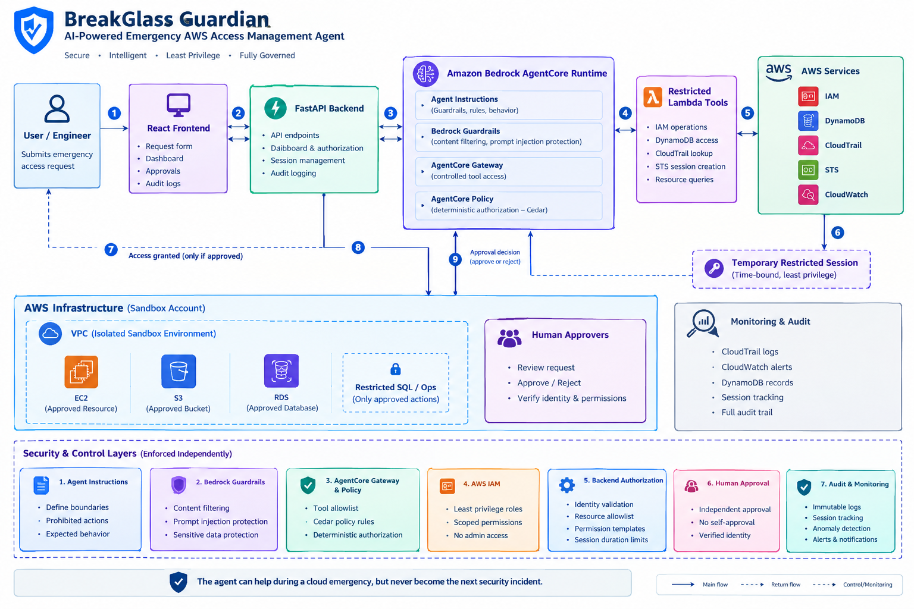

# BreakGlass Guardian

Article for Agents, your rules: Bedrock Managed Agents build:
https://builder.aws.com/project/3MMhqkIgJpa7rQP3SHJXlrel3x3/breakglass-guardian-building-an-ai-agent-that-knows-when-to-say-no

Demo Video: https://www.youtube.com/watch?v=pXU9REXJ8js



BreakGlass Guardian is an emergency AWS access-management dashboard and API.
It combines deterministic security validation, human approval, temporary AWS
credentials, DynamoDB persistence, and audit reporting.

## Features

- Emergency access request submission
- Deterministic risk scoring and least-privilege permission recommendations
- Authorized human approval and rejection
- Self-approval prevention
- MFA-gated approval decisions
- Approval expiration and replay protection
- Temporary AWS STS sessions
- Session revocation and expiration tracking
- DynamoDB-backed request, approval, session, and audit records
- React dashboard for requests, approvals, sessions, and security audit
- Optional Bedrock integration, disabled by default

## Architecture

```text
React Dashboard
      |
      v
FastAPI API
      |
      +--> Request validation
      +--> Risk engine
      +--> Approval service
      +--> Session service
      +--> Audit service
      |
      v
AWS IAM / STS / DynamoDB
```

Bedrock is supplementary only. It does not grant access or make approval
decisions. AWS authorization and the final approval decision are enforced by
the backend and AWS IAM.

## Repository Structure

```text
backend/
  agent/
  api/
  models/
  security/
  services/
  tests/
frontend/
  public/
  src/
infrastructure/
  bedrock/
  dynamodb/
  iam/
docs/
  architecture.md
  security_rules.md
  threat_model.md
```

## Prerequisites

- Python 3.12
- Node.js 20.19 or later
- npm
- AWS CLI
- An AWS account with deployed BreakGlass infrastructure

## Backend Setup

Create and activate a virtual environment:

```bash
python -m venv venv
```

Windows:

```powershell
.\venv\Scripts\Activate.ps1
```

Linux or macOS:

```bash
source venv/bin/activate
```

Install Python dependencies:

```bash
pip install -r requirements.txt
```

Create the local environment file:

```bash
cp .env.example .env
```

Update at least these values in `.env`:

```env
AWS_REGION=us-east-1
AWS_ACCOUNT_ID=your-account-id
ENVIRONMENT=dev
USE_LOCAL_MODE=true
AUTH_ENABLED=false
BEDROCK_ENABLED=false
```

Use `USE_LOCAL_MODE=false` only after configuring DynamoDB and AWS credentials.

Start the backend:

```bash
python -m backend.main
```

The API is available at `http://127.0.0.1:8001` when `API_PORT=8001`.

Health endpoint:

```text
http://127.0.0.1:8001/health
```

API documentation is available at `/docs` only when `DEBUG=true`.

## Frontend Setup

Copy the frontend environment template:

```bash
cd frontend
cp .env.example .env.local
npm install
npm run dev
```

The dashboard is normally available at:

```text
http://127.0.0.1:5173
```

Set the backend URL in `frontend/.env.local`:

```env
VITE_API_BASE_URL=http://127.0.0.1:8001
```

Build the production frontend:

```bash
npm run build
```

## AWS Infrastructure

Deploy DynamoDB tables:

```bash
aws cloudformation deploy \
  --template-file infrastructure/dynamodb/tables.yaml \
  --stack-name breakglass-dynamodb \
  --parameter-overrides Environment=dev \
  --region us-east-1
```

Deploy IAM roles:

```bash
aws cloudformation deploy \
  --template-file infrastructure/iam/roles.yaml \
  --stack-name breakglass-iam \
  --parameter-overrides Environment=dev BackendRoleArn=<backend-role-or-bootstrap-principal-arn> \
  --capabilities CAPABILITY_NAMED_IAM \
  --region us-east-1
```

The deployed restricted role trust policies must ultimately trust the backend
application role rather than a local CLI user.

Deploy optional Bedrock infrastructure:

```bash
aws cloudformation deploy \
  --template-file infrastructure/bedrock/agent.yaml \
  --stack-name breakglass-bedrock \
  --parameter-overrides Environment=dev \
  --capabilities CAPABILITY_NAMED_IAM \
  --region us-east-1
```

Bedrock Agent creation and model invocation remain subject to AWS account
entitlements.

## Authentication

For local development, set:

```env
USE_LOCAL_MODE=true
AUTH_ENABLED=false
DEBUG=true
```

The dashboard can create a loopback-only development token while
`DEBUG=true`. Do not enable this login mode outside local development.

For production, integrate a real identity provider and set:

```env
USE_LOCAL_MODE=false
AUTH_ENABLED=true
AUTH_SECRET_KEY=<strong-random-secret>
```

Approvers must differ from requesters and must have an authorized approver
identity. Approval MFA must be enforced by the identity provider or a separate
server-side MFA challenge.

## Emergency Request Example

```json
{
  "requester_email": "engineer@company.com",
  "requester_name": "John Engineer",
  "emergency_description": "Production EC2 instance is unresponsive and requests are timing out.",
  "resource_type": "ec2",
  "resource_id": "i-0123456789abcdef0",
  "resource_region": "us-east-1",
  "requested_action": "restart_instance",
  "duration_minutes": 30,
  "business_justification": "The customer-facing application is unavailable and requires immediate service restoration."
}
```

## Approval Workflow

1. Submit an emergency request.
2. The backend validates identity, policy, resource scope, permissions, and duration.
3. A medium or higher risk request remains pending approval.
4. An authorized human approver reviews the request.
5. The approver approves or rejects it.
6. The backend verifies the approval against the original request.
7. A single-use approval can create a temporary AWS session.
8. The session is tracked and can be revoked.

Bedrock, if enabled, provides supplementary analysis only. It does not approve
requests or issue credentials.

## Testing

Run backend tests:

```bash
pytest backend/tests/ -v
```

Run with a coverage report:

```bash
pytest backend/tests/ --cov=backend --cov-report=html
```

Run frontend checks:

```bash
cd frontend
npm run build
npm run lint
```

## Security Notes

This is a security demonstration and must not be treated as production-ready
without additional work:

- Replace local development authentication with a verified OIDC/JWKS identity provider.
- Replace boolean MFA with provider-issued MFA assurance or WebAuthn.
- Run integration tests against a dedicated AWS sandbox.
- Add CloudWatch alarms and durable notification workflows.
- Secure APIs behind HTTPS and an approved reverse proxy or API gateway.
- Review all IAM role policies for the target AWS environment.

## Configuration

See [frontend/.env.example](frontend/.env.example) for the frontend API URL.

## Documentation

- [Architecture](docs/architecture.md)
- [Security rules](docs/security_rules.md)
- [Threat model](docs/threat_model.md)
- [AWS deployment guide](AWS_DEPLOYMENT_GUIDE.md)
